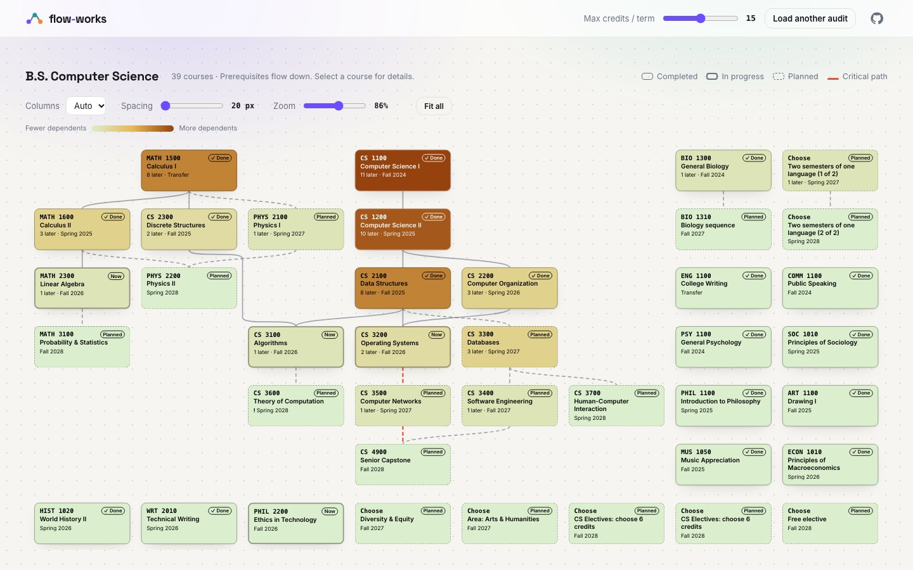
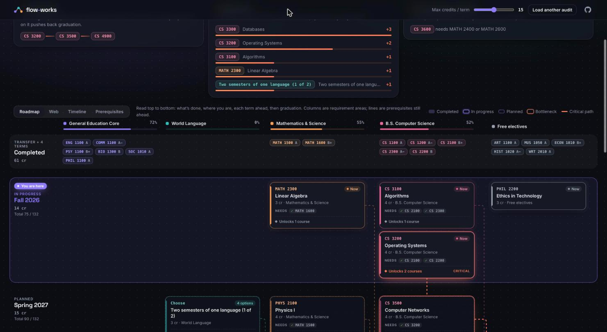
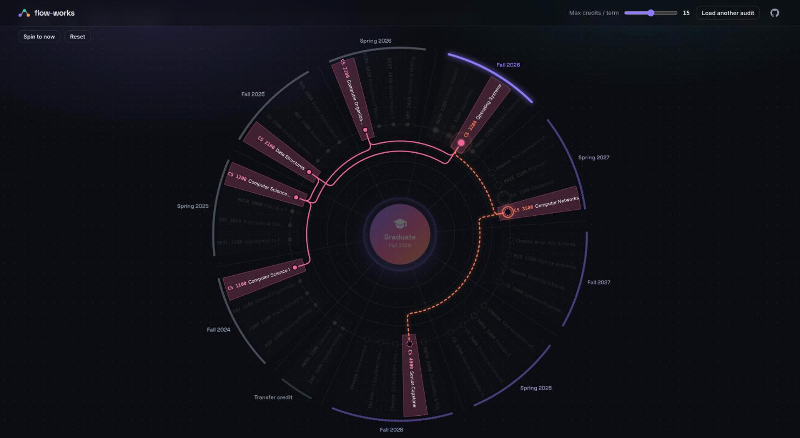
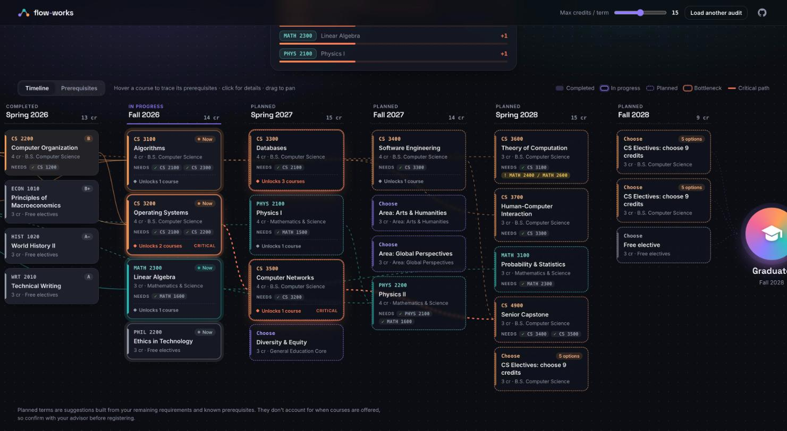
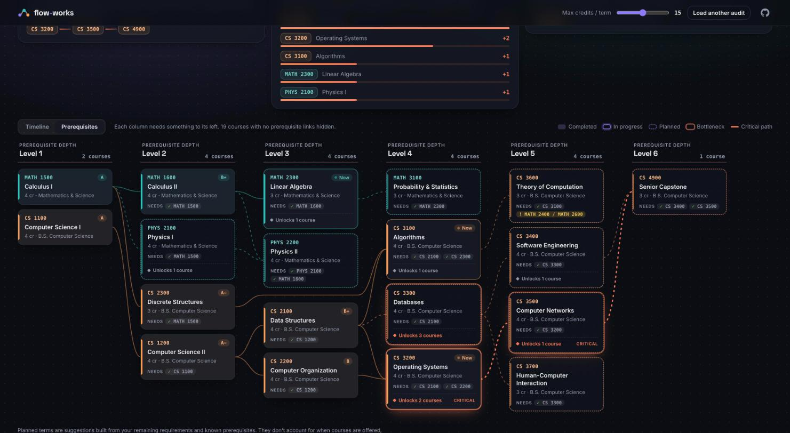

# Flow-works

**Your Degree Works audit, as an animated flowchart.**

Flow-works turns an Ellucian Degree Works audit into a semester-by-semester map: what you've finished, what you're taking now, and a suggested plan for everything left, with every prerequisite drawn in. It also shows which courses are the bottlenecks between you and graduation.

**[Try the live demo →](https://frostdev-ops.github.io/flow-works/#demo)**



## Views

**Roadmap** (the default) reads top to bottom like a plan on paper. Everything you've finished sits in one compact row at the top. Below it, the current term is marked *You are here*, then each planned term follows with its credit total and running total, and Graduation sits at the bottom. Columns are your requirement areas, so you can read straight down your major or your gen-eds. Lines show only the prerequisites still ahead. They run in the channels between columns and the gutters between rows, so they never cross a card. Hover a card to light up the completed courses it builds on.



**Web** puts graduation at the hub and every course on one ring, with your terms running clockwise. Each course owns a slice of the wheel (a big click target), prerequisite lines travel on concentric lanes so they never cross a course, and bottlenecks grow bigger dots. Drag to spin it; clicking a course, a term name, or stepping with ← → turns it to where labels read straight across.



**Timeline** is the curriculum view. Columns are terms: transfer credit, completed terms, the current term, then planned terms through graduation. Each card lists its prerequisites (✓ met, **!** missing) and how many later courses it unlocks.



**Prerequisites** is the dependency view. Columns are prerequisite depth: everything in a column needs something to its left. Bottlenecks fan out visibly, and the critical path is drawn in bold.



Every view shares three insights:

- **Critical path:** your longest prerequisite chain still ahead. It sets the minimum number of terms you have left.
- **Bottlenecks:** unfinished courses ranked by how many later courses depend on them.
- **Check with your advisor:** prerequisites that aren't on your record or in the plan.

Lines never pass under a card: a line that spans several columns gets a reserved gap in each column it crosses, and cards are re-ordered to cut crossings. Hover a course to trace its whole chain. Click any course, in any view, for a flowchart of its prerequisite tree and everything it unlocks; click a course in that chart to follow the chain, with a breadcrumb trail back. Drag the max-credits slider and the plan re-flows with animation.

## Use it

1. Open **[frostdev-ops.github.io/flow-works](https://frostdev-ops.github.io/flow-works/)** and drag the **Flow-works** button to your bookmarks bar.
2. Sign in to Degree Works and open your worksheet.
3. Click the bookmark.

The bookmarklet reads the audit you're already viewing (same site, your own session), looks up each course's prerequisites, and opens Flow-works with the data packed into the URL fragment.

### Privacy

- Nothing is uploaded. The data travels in the `#fragment`, which browsers never send to servers, and the page itself is static files on GitHub Pages.
- Your student ID and email are removed before the data leaves the Degree Works tab.
- The audit stays in your browser's `localStorage` until you click **Load another audit**.
- It's about 700 lines of plain JavaScript with no dependencies, so you can read all of it.

## Does it work with my school?

Flow-works reads the Degree Works **Responsive Dashboard** API (`/responsiveDashboard/api/audit`, plus `api/course-link` for prerequisites). If your worksheet URL contains `/responsivedash/` or `/responsiveDashboard/`, it should work. It was developed against a live Responsive Dashboard install. Schools configure their audits differently, so if yours looks wrong, please [open an issue](https://github.com/frostdev-ops/flow-works/issues) with the shape that broke. Never post your real audit; the field names are enough.

## How the plan is made

Remaining requirements come from each rule's *still needed* advice. Choice rules ("choose 9 credits from…") become one card per course slot, and any remaining credit gap is filled with free electives. Courses are scheduled into upcoming Fall/Spring terms greedily:

1. Courses that head the longest remaining prerequisite chains go first, then lower course levels.
2. A course never lands in the same term as, or before, its prerequisites.
3. Each term stays under the max-credits limit.

Prerequisites are read as an AND of OR-groups. Test-score alternatives and parenthesis nesting are ignored. The planner doesn't know which terms a course is offered in, so treat the plan as a starting point for a conversation with your advisor. It isn't a registration plan.

## Development

No build step and no dependencies.

```sh
python3 -m http.server 8000   # then open http://localhost:8000/#demo
node test.mjs                 # parser, planner and prerequisite analysis checks
```

| File | What it does |
| --- | --- |
| `model.js` | Pure functions: audit JSON → model, the planner, prerequisite analysis, graph layout, edge routing |
| `app.js` | Rendering, animation (FLIP and SVG line drawing), interactions |
| `bookmarklet.js` | Runs on Degree Works; `app.js` turns it into the drag-to-bookmarks link |
| `demo.json` | A fictional student in the real API shape |
| `index.html`, `style.css` | The page |

You can also load a saved audit JSON file (the raw `api/audit` response) with **Load audit JSON** or by dropping it on the page.

## License

MIT
